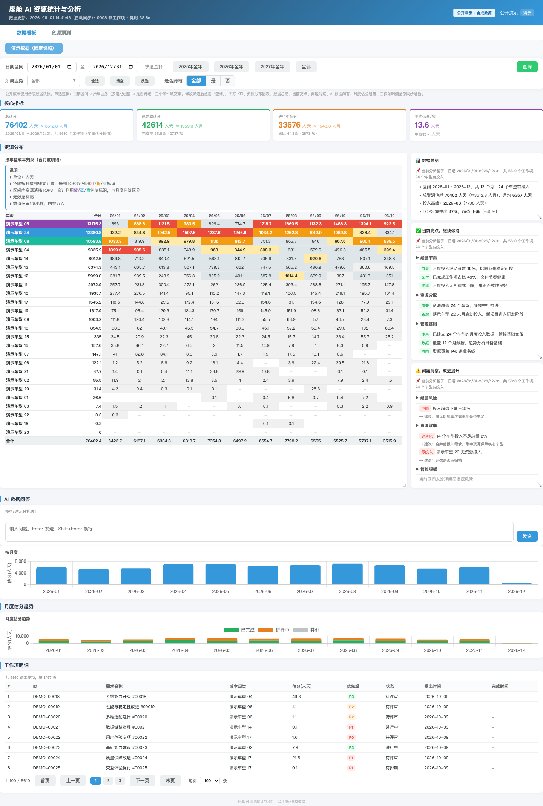

# AI 资源规划与分析看板

面向研发资源规划场景的交互式数据看板，提供资源投入分析、月度趋势、工作项明细和年度预测视图。本仓库是可公开访问的静态演示版本，无需后端即可部署到 GitHub Pages。



## 在线演示

[打开公网演示](https://wx865828625-stack.github.io/ai-resource-dashboard-demo/)

## 主要能力

- 按日期、业务线和跨域属性组合筛选
- 核心指标、月度资源矩阵和趋势图表联动
- 近万条演示工作项分页浏览
- 车型、OS、平台三个资源预测视图
- 绿色到红色的投入热力图
- 只读历史版本和模拟分析问答

## 数据说明

仓库内的项目名称、工作项、标识符、组织标签、排期日期、预测数值和分析文字均为确定性合成数据。仓库不包含生产凭证、用户账号、登录记录、内部链接或企业原始数据。

公开版本刻意保持只读：数据刷新、配置修改、报告编辑、版本回滚和内部系统集成均已禁用。

## 本地预览

使用任意静态 Web 服务启动仓库目录，然后访问 `index.html`。由于浏览器会限制本地 JSON 请求，不支持直接双击 HTML 文件打开。

```bash
python3 -m http.server 8080
```

## 技术实现

前端为静态 HTML 应用，图表使用 Chart.js。`demo-runtime.js` 将原应用的只读接口映射到 `demo-data/` 下的合成快照，因此无需服务器或密钥也能保留主要交互体验。

## 安全边界

公开演示数据由独立导出工具生成，不复制原始名称、ID、日期或数值。管理后台和写接口不会进入可用的演示流程，提交前会执行敏感信息与大文件检查。

本仓库用于作品展示，默认未授予开源许可。
